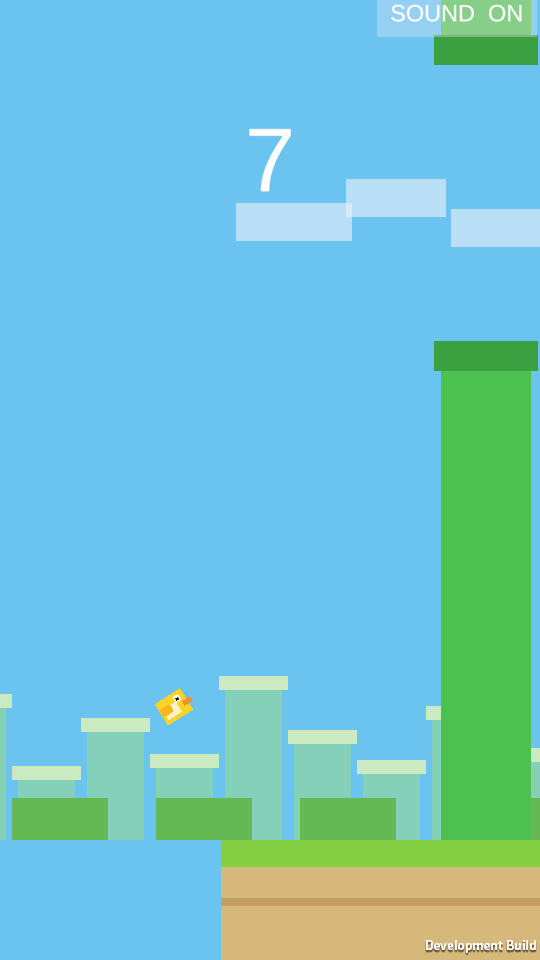

# Flappy Copy

A small, complete **Flappy Bird** style game for **Unity 6.5 (6000.5.1f1)** with the URP 2D renderer. Every
sprite, and every sound, is generated by the project itself: no downloaded art, no paid packages, no audio
files from outside the repository.



---

## English

### Overview

- **Bird** — Space, a click or a tap gives an upward impulse through a `Rigidbody2D`; gravity pulls it down and
  the sprite tilts with the vertical speed. Hitting a pipe or the ground, or flying out of the top of the frame,
  ends the run.
- **Pipes** — top/bottom pairs with a random gap that shrinks with the score and a scroll speed that slowly
  rises. Pairs come from an object pool, so there is no `Instantiate`/`Destroy` while playing; the lane wraps
  so the run never runs out of pipes, on any window size.
- **Score** — one point per cleared pair, a best score kept in `PlayerPrefs` and a "NEW RECORD!" badge.
- **Sound** — flap, point, hit and ground thud, generated as short WAV clips at build time; a **SOUND ON/OFF**
  button mutes everything and remembers the choice.
- **Look** — endless wrapping ground, clouds and a town silhouette in parallax, a portrait 9:16 camera and a
  HUD that follows it on phones, on 9:16 and on wide desktop windows.
- **States** — Menu → Playing → Game Over, with a restart button, a tap, Space or `R`.

### Controls

| Action | Input |
|---|---|
| Start / flap / restart | `Space`, left mouse button, touch, or the full-screen button |
| Restart after a crash | `R` |
| Mute / unmute | **SOUND** button (top right) |

### Downloads

The latest release ships a build for every platform the project can target:

| Platform | Archive | How to run |
|---|---|---|
| Windows x64 | `FlappyCopy-Windows.zip` | unpack and run `Windows/FlappyCopy.exe` |
| Linux x64 | `FlappyCopy-Linux.zip` | unpack, `chmod +x Linux/FlappyCopy.x86_64`, then run it |
| WebGL | `FlappyCopy-WebGL.zip` | serve the unpacked `WebGL/` folder with any static web server and open it in a browser |
| Android | `FlappyCopy-Android.apk` | install on Android 8.0+ (API 26) |

Every archive keeps its build in a folder named after the platform (`Windows/`, `Linux/`, `WebGL/`), and
`VERSION.txt` lists the SHA-256 of each file. The WebGL page fills the whole browser window at any aspect
ratio, from a phone in portrait to a wide desktop screen.

### Requirements

- **Unity 6.5** with the exact editor version `6000.5.1f1` (Unity Hub installs it).
- To build a player: the matching build support module for the target platform
  (Windows, Linux, WebGL or Android).
- No prior Unity experience is needed to play: the built players are attached to the releases.

### Run from the editor

1. Clone the repository and open the folder in **Unity Hub** with editor `6000.5.1f1` (the first open builds
   the `Library` folder).
2. Open `Assets/Scenes/Game.unity` (the only scene in Build Settings).
3. Press **Play**.

The scene, prefabs and data assets are committed, so a fresh clone runs as is. After changing component
scripts, use **Flappy Copy ▸ Repair Assets** once — it re-imports the scripts and regenerates the data,
prefabs and the scene, then validates.

### Build

- **From the editor** — `File ▸ Build Profiles` (or `File ▸ Build Settings`) → pick the platform → **Build**.
- **Windows from the command line** — `Tools\build_windows.bat [path\to\Unity.exe]` writes
  `Builds\Windows\FlappyCopy.exe`.
- **Release archives for every installed platform** —

  ```bat
  Tools\build_release.bat [path\to\Unity.exe]
  ```

  validates the project first and stops on any issue, then builds and archives each platform whose build
  support is installed:

  | Platform | Archive |
  |---|---|
  | Windows x64 | `Builds\Release\FlappyCopy-Windows.zip` |
  | Linux x64 | `Builds\Release\FlappyCopy-Linux.zip` |
  | WebGL | `Builds\Release\FlappyCopy-WebGL.zip` (the `FlappyCopy` project template fills the browser window; any static web server can host the folder) |
  | Android | `Builds\Release\FlappyCopy-Android.apk` (portrait, API 26+) |

  `Builds\Release\VERSION.txt` lists the version and the SHA-256 of every archive.

Player settings (applied by **Flappy Copy ▸ Apply Player Settings**): product name `Flappy Copy`, version
`1.0.1`, 720×1280 windowed on desktop, portrait only on mobile, legacy Input Manager, URP 2D.

Built players of the latest release are attached to the repository's releases; `Tools\fetch_releases.ps1`
downloads them next to their notes (and their SHA-256 list) into the ignored `Releases\` folder.

### Continuous integration

`.github/workflows/release.yml` builds and publishes the archives for every platform on a `v*` tag (or by hand
from the Actions tab); `.github/workflows/tests.yml` runs the EditMode suite on pushes and pull requests. Both
need three repository secrets: `UNITY_LICENSE`, `UNITY_EMAIL` and `UNITY_PASSWORD`.

### Architecture

```
Assets/Scripts (FlappyCopy.Runtime)
├── Core/       GameController (composition root + game loop), GameStateMachine + MenuState/PlayingState/
│               GameOverState (State pattern), GameConstants + DesignSpace, DifficultyRules + GapPlacement
│               (engine-free rules), CollisionRelay, LayersBootstrapper (layers/tags/sorting layers),
│               PlayerInputReader + PressPolicy
├── Audio/      SfxId, IAudioService + NullAudioService, AudioService (playback + mute), SfxLibrary
│               (clip synthesis), SoundPreference (memory / PlayerPrefs)
├── Cameras/    PortraitFraming (9:16 camera for any window), ViewMetrics (real screen size)
├── Data/       PlayerSettings, PipeSettings, WorldSettings  (ScriptableObjects: all tuning)
├── Input/      IInputSource, UnityInputSource (Space/mouse/touch), ScriptedInputSource
├── Pipes/      IPipePair + PipeRun (pooled lane, scroll wrap), PipePair (sprites + hitboxes),
│               PipePassGate + PipePassRule + PipePassSensor (one point per pair), PipeSpawner, PipeRunMath
├── Player/     BirdController (Rigidbody2D motion, tilt, crash), BirdKinematics (pure model)
├── Pooling/    ObjectPool<T>, IPoolFactory, PrefabPoolFactory, IPoolable
├── Score/      IScoreService, ScoreService (events), IScoreStorage, PlayerPrefsScoreStorage
├── Testing/    SelfTestChecks + SelfTestBootstrap (checks of the test player build)
├── UI/         HudController (event subscriber), HudView (texts/panels/buttons), HudFlow, PlayAreaButton,
│               DeviceRect, PortraitHudScaler
├── World/      InfinityGround (wrapping strips), ParallaxScroller, ScrollMath, GroundFitter, ScreenFitter
```

The loop is `GameController.StepFrame()`: read the input policy for the current state, then idle the bird
(menu), run pipes/ground/bird (playing) or let it fall (game over). A crash arrives as an event from the bird's
trigger hitbox: `CollisionRelay` → `BirdController.OnCollisionEntered` → `GameController.NotifyBirdCrashed` →
`GameStateMachine` (plus the hit and ground sounds).

**Design rules kept throughout:** one class, one job; interfaces where they pay off; an object pool instead of
runtime allocation; the State pattern for the game flow; events for the UI; all tuning in ScriptableObjects; no
singletons; no magic numbers or strings.

### Editor tooling

| Menu | Command line (`-executeMethod`) | Purpose |
|---|---|---|
| Flappy Copy ▸ Rebuild Scene, Prefabs and Data | `FlappyCopy.EditorTools.EditorSetup.PrepareAndExit` | data assets, `Bird`/`PipePair` prefabs, `Game.unity`, build list, player settings, then validation |
| Flappy Copy ▸ Repair Assets | `FlappyCopy.EditorTools.SceneRepair.RebuildAndExit` | re-import component scripts, rebuild everything, validate |
| Flappy Copy ▸ Validate Project | `FlappyCopy.EditorTools.ProjectValidator.RunAndExit` | scene references, prefab colliders/components, sprite material, layers, input handler, build list |
| Flappy Copy ▸ Apply Player Settings | `FlappyCopy.EditorTools.PlayerSetup.ApplyMenu` | product/version/window/orientation/input handler |
| Flappy Copy ▸ Audio ▸ Rebuild Sound Effects | `FlappyCopy.EditorTools.AudioAssetBuilder.CreateAll` | writes the four WAV clips into `Assets/Resources` |
| Flappy Copy ▸ Release ▸ Build All Platforms | `FlappyCopy.EditorTools.ReleaseBuilder.BuildAllAndExit` | validate, build, archive every installed platform |
| Flappy Copy ▸ Build ▸ Windows | `FlappyCopy.EditorTools.CiEntry.BuildWindowsCi` | player build to `Builds\Windows` |
| Flappy Copy ▸ Build ▸ Test Player | `FlappyCopy.EditorTools.SelfTestBuild.BuildAndExit` | test player with runtime scene and run checks |
| Flappy Copy ▸ Open Game Scene | — | opens `Assets/Scenes/Game.unity` |

### Tests

`Assets/Tests/EditMode` holds **67 EditMode checks** (plain NUnit):

| Fixture | What it checks |
|---|---|
| `LogicTests` | state machine transitions, callbacks, input policy; scoring and the record; the object pool; the pipe lane (wrap, spacing, recycling, gap roll); pass-through scoring; difficulty ramp and gap placement; bird kinematics; camera framing and the play area; ground strip tiling; HUD rules |
| `ObjectPoolTests` | pool prewarm, take/release accounting, callbacks, release-all, double release, null factory |
| `GameSceneTests` | scene/prefabs/settings exist, prefabs carry their scripts, the sprite is one unit with a bottom-left pivot, the ground covers the frame, audio clips exist, legacy input, pool reuse |
| `AudioTests` | generated clips have samples and are not clipped, the envelope is click-free, the mute preference round-trips, the effect order is pinned |
| `TestBootstrapTests` | the assembly always loads a decorated fixture; a run's pairs pass the scoring rule |

```bat
Tools\run_editmode_tests.ps1
```

prints the summary, writes `Logs/harness/editmode_results.json` and exits 0 when every check passed (or run
`Window ▸ General ▸ Test Runner ▸ EditMode ▸ Run All`). `Tools/TESTS.md` explains both entry points, and the
**test player** (`FlappyCopy.EditorTools.SelfTestBuild.BuildAndExit`) exercises the physics in a real build:
it checks the scene wiring and both prefabs, plays one run into the ground, and passes one pair through the
scoring sensor.

### Known limitations

- macOS players are not built by the release script (Unity cannot build them from Windows).
- No music: only the four short generated effects.
- The sound toggle is a HUD button; there is no keyboard shortcut for it.

### License

MIT — see [LICENSE.md](LICENSE.md). Unity Engine and URP are used under the Unity Personal license.

---

## Русский

Небольшая законченная игра в стиле **Flappy Bird** на **Unity 6.5 (6000.5.1f1)** с рендерером URP 2D. Все
спрайты и все звуки создаются самим проектом: никаких скачанных картинок, платных пакетов и звуковых файлов
со стороны.


### Об игре

- **Птица** — пробел, клик или касание дают импульс вверх через `Rigidbody2D`; гравитация тянет вниз, спрайт
  наклоняется по вертикальной скорости. Касание трубы или земли и вылет за верхний край кадра завершают раунд.
- **Трубы** — пары сверху и снизу со случайным зазором, который сужается с ростом счёта, и постепенно ускоряющийся
  скролл. Пары берутся из пула объектов, поэтому во время игры нет ни `Instantiate`, ни `Destroy`; полоса труб
  зациклена — игра не «кончается» из-за нехватки труб при любом размере окна.
- **Счёт** — очко за каждую пройденную пару; рекорд хранится в `PlayerPrefs`, на экране результата есть
  надпись «NEW RECORD!».
- **Звук** — взмах, очко, удар и удар о землю: короткие WAV-клипы создаются при сборке. Кнопка
  **SOUND ON/OFF** выключает звук и запоминает выбор.
- **Внешний вид** — бесконечная земля из зацикленных полос, облака и силуэт города с параллаксом, портретная
  камера 9:16 и интерфейс, который масштабируется вместе с ней на телефонах, в 9:16 и в широких окнах.
- **Состояния** — меню → игра → конец игры, с кнопкой рестарта, касанием, пробелом или клавишей `R`.

### Управление

| Действие | Ввод |
|---|---|
| Старт / взмах / рестарт | `Пробел`, левая кнопка мыши, касание или полноэкранная кнопка |
| Рестарт после падения | `R` |
| Выключить / включить звук | кнопка **SOUND** (справа сверху) |

### Скачивание

В последнем релизе собраны версии для всех платформ, которые поддерживает проект:

| Платформа | Архив | Как запустить |
|---|---|---|
| Windows x64 | `FlappyCopy-Windows.zip` | распакуйте и запустите `Windows/FlappyCopy.exe` |
| Linux x64 | `FlappyCopy-Linux.zip` | распакуйте, `chmod +x Linux/FlappyCopy.x86_64` и запустите |
| WebGL | `FlappyCopy-WebGL.zip` | отдайте распакованную папку `WebGL/` любым статическим веб-сервером и откройте в браузере |
| Android | `FlappyCopy-Android.apk` | установите на Android 8.0+ (API 26) |

В каждом архиве сборка лежит в папке с именем платформы (`Windows/`, `Linux/`, `WebGL/`), а `VERSION.txt`
содержит SHA-256 всех файлов. Страница WebGL занимает всё окно браузера при любом соотношении сторон — от
телефона в портретной ориентации до широкого монитора.

### Требования

- **Unity 6.5**, конкретная версия редактора `6000.5.1f1` (ставится через Unity Hub).
- Для сборки плеера — модуль поддержки нужной платформы (Windows, Linux, WebGL или Android).
- Опыт работы с Unity для запуска игры не нужен: готовые сборки приложены к релизам репозитория.

### Запуск в редакторе

1. Склонируйте репозиторий и откройте папку в **Unity Hub** редактором `6000.5.1f1` (при первом открытии
   Unity соберёт папку `Library`).
2. Откройте `Assets/Scenes/Game.unity` — это единственная сцена в Build Settings.
3. Нажмите **Play**.

Сцена, префабы и данные уже в репозитории, поэтому свежий клон запускается сразу. После изменения скриптов
компонентов один раз выполните **Flappy Copy ▸ Repair Assets**: команда заново импортирует скрипты,
пересоберёт данные, префабы и сцену и проверит проект.

### Сборка

- **Из редактора** — `File ▸ Build Profiles` (или `File ▸ Build Settings`) → выберите платформу → **Build**.
- **Windows из командной строки** — `Tools\build_windows.bat [путь\к\Unity.exe]` создаст
  `Builds\Windows\FlappyCopy.exe`.
- **Релизные архивы для всех установленных платформ:**

  ```bat
  Tools\build_release.bat [путь\к\Unity.exe]
  ```

  сначала проверяет проект и останавливается при любой ошибке, затем собирает и упаковывает каждую платформу,
  для которой установлен модуль сборки:

  | Платформа | Архив |
  |---|---|
  | Windows x64 | `Builds\Release\FlappyCopy-Windows.zip` |
  | Linux x64 | `Builds\Release\FlappyCopy-Linux.zip` |
  | WebGL | `Builds\Release\FlappyCopy-WebGL.zip` (шаблон проекта `FlappyCopy` растягивает игру на всё окно; папку можно отдавать любым статическим веб-сервером) |
  | Android | `Builds\Release\FlappyCopy-Android.apk` (портрет, API 26+) |

  В `Builds\Release\VERSION.txt` записаны версия и SHA-256 каждого архива.

Готовые сборки последнего релиза приложены к релизам репозитория; `Tools\fetch_releases.ps1` скачивает их
вместе с описанием (и списком SHA-256) в папку `Releases\` (она не попадает в git).

### Непрерывная интеграция

`.github/workflows/release.yml` собирает и прикладывает архивы всех платформ по тегу `v*` (или вручную из
вкладки Actions); `.github/workflows/tests.yml` прогоняет набор EditMode на каждый push и pull request. Обоим
нужны три секрета репозитория: `UNITY_LICENSE`, `UNITY_EMAIL` и `UNITY_PASSWORD`.

Настройки плеера (применяются командой **Flappy Copy ▸ Apply Player Settings**): название `Flappy Copy`,
версия `1.0.1`, окно 720×1280 на десктопе, только портретная ориентация на мобильных, старый Input Manager,
URP 2D.

### Архитектура

```
Assets/Scripts (FlappyCopy.Runtime)
├── Core/       GameController (точка сборки + игровой цикл), GameStateMachine + MenuState/PlayingState/
│               GameOverState (паттерн «Состояние»), GameConstants + DesignSpace, DifficultyRules + GapPlacement
│               (правила без движка), CollisionRelay, LayersBootstrapper (слои/теги/слои сортировки),
│               PlayerInputReader + PressPolicy
├── Audio/      SfxId, IAudioService + NullAudioService, AudioService (проигрывание + mute), SfxLibrary
│               (синтез клипов), SoundPreference (память / PlayerPrefs)
├── Cameras/    PortraitFraming (камера 9:16 для любого окна), ViewMetrics (реальный размер экрана)
├── Data/       PlayerSettings, PipeSettings, WorldSettings  (ScriptableObject: все настройки)
├── Input/      IInputSource, UnityInputSource (пробел/мышь/касание), ScriptedInputSource
├── Pipes/      IPipePair + PipeRun (пул и полоса труб), PipePair (спрайты + хитбоксы),
│               PipePassGate + PipePassRule + PipePassSensor (очко за пару), PipeSpawner, PipeRunMath
├── Player/     BirdController (движение на Rigidbody2D, наклон, авария), BirdKinematics (чистая модель)
├── Pooling/    ObjectPool<T>, IPoolFactory, PrefabPoolFactory, IPoolable
├── Score/      IScoreService, ScoreService (события), IScoreStorage, PlayerPrefsScoreStorage
├── Testing/    SelfTestChecks + SelfTestBootstrap (проверки тестовой сборки)
├── UI/         HudController (подписчик событий), HudView (тексты/панели/кнопки), HudFlow, PlayAreaButton,
│               DeviceRect, PortraitHudScaler
└── World/      InfinityGround (зацикленные полосы земли), ParallaxScroller, ScrollMath, GroundFitter, ScreenFitter
```

Игровой цикл — `GameController.StepFrame()`: читает политику ввода для текущего состояния, затем «покачивает»
птицу (меню), двигает трубы, землю и птицу (игра) или даёт ей падать (конец игры). Авария приходит событием
от триггерного хитбокса птицы: `CollisionRelay` → `BirdController.OnCollisionEntered` →
`GameController.NotifyBirdCrashed` → `GameStateMachine` (и звуки удара и земли).

**Принципы, выдержанные по всему проекту:** один класс — одна задача; интерфейсы там, где они оправданы; пул
объектов вместо выделения памяти в рантайме; паттерн «Состояние» для потока игры; события для интерфейса; все
настройки в ScriptableObject; никаких синглтонов; никаких «магических» чисел и строк.

### Инструменты редактора

| Меню | Командная строка (`-executeMethod`) | Назначение |
|---|---|---|
| Flappy Copy ▸ Rebuild Scene, Prefabs and Data | `FlappyCopy.EditorTools.EditorSetup.PrepareAndExit` | данные, префабы `Bird`/`PipePair`, `Game.unity`, список сборки, настройки плеера, затем проверка |
| Flappy Copy ▸ Repair Assets | `FlappyCopy.EditorTools.SceneRepair.RebuildAndExit` | переимпорт скриптов компонентов, полная пересборка, проверка |
| Flappy Copy ▸ Validate Project | `FlappyCopy.EditorTools.ProjectValidator.RunAndExit` | ссылки в сцене, коллайдеры и компоненты префабов, материал спрайтов, слои, ввод, список сборки |
| Flappy Copy ▸ Apply Player Settings | `FlappyCopy.EditorTools.PlayerSetup.ApplyMenu` | название/версия/окно/ориентация/обработчик ввода |
| Flappy Copy ▸ Audio ▸ Rebuild Sound Effects | `FlappyCopy.EditorTools.AudioAssetBuilder.CreateAll` | создаёт четыре WAV-клипа в `Assets/Resources` |
| Flappy Copy ▸ Release ▸ Build All Platforms | `FlappyCopy.EditorTools.ReleaseBuilder.BuildAllAndExit` | проверка, сборка и упаковка всех установленных платформ |
| Flappy Copy ▸ Build ▸ Windows | `FlappyCopy.EditorTools.CiEntry.BuildWindowsCi` | сборка плеера в `Builds\Windows` |
| Flappy Copy ▸ Build ▸ Test Player | `FlappyCopy.EditorTools.SelfTestBuild.BuildAndExit` | тестовый плеер с проверками сцены и раунда |
| Flappy Copy ▸ Open Game Scene | — | открывает `Assets/Scenes/Game.unity` |

### Тесты

`Assets/Tests/EditMode` содержит **67 проверок EditMode** (обычный NUnit):

| Набор | Что проверяет |
|---|---|
| `LogicTests` | переходы автомата состояний, колбэки, политику ввода; счёт и рекорд; пул объектов; полосу труб (зацикливание, шаг, переиспользование, зазор); начисление за пройденную пару; рост сложности и размещение зазора; кинематику птицы; кадрирование камеры и игровую область; тайлинг земли; правила интерфейса |
| `ObjectPoolTests` | прогрев пула, учёт взятия/возврата, колбэки, возврат всех, двойной возврат, пустая фабрика |
| `GameSceneTests` | наличие сцены/префабов/настроек, скрипты в префабах, спрайт размером в единицу с левым нижним пивотом, земля закрывает кадр, звуковые клипы, старый Input Manager, переиспользование пула |
| `AudioTests` | в сгенерированных клипах есть сэмплы и нет перегрузки, огибающая без щелчков, выбор mute сохраняется, порядок эффектов зафиксирован |
| `TestBootstrapTests` | сборка всегда загружает размеченный фикстур; пары раунда проходят правило начисления |

```bat
Tools\run_editmode_tests.ps1
```

печатает сводку, пишет `Logs/harness/editmode_results.json` и выходит с кодом 0, если всё прошло (или:
`Window ▸ General ▸ Test Runner ▸ EditMode ▸ Run All`). `Tools/TESTS.md` описывает оба способа; **тестовый
плеер** (`FlappyCopy.EditorTools.SelfTestBuild.BuildAndExit`) проверяет физику в реальной сборке: связку сцены
и оба префаба, падение на землю и начисление очка за пройденную пару.

### Известные ограничения

- Скрипт релиза не собирает плееры для macOS: Unity не умеет собирать их под Windows.
- Музыки нет — только четыре коротких сгенерированных эффекта.
- Переключатель звука — кнопка интерфейса, сочетания клавиш для него нет.

### Лицензия

MIT — см. [LICENSE.md](LICENSE.md). Unity Engine и URP используются по лицензии Unity Personal.
